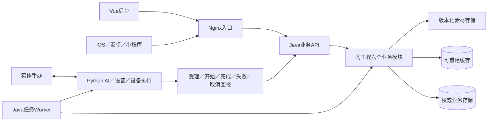

# ADR-002 · Java 业务核心与服务边界

状态：**已接受** · 决策日期：2026-10-12 · 确认人：用户。

用户原文：“业务核心用java；符合范围预取；边界合适”。承接上一轮三个明确议题：Java业务核心、一期角色生活／事件状态、后台与App共用核心且Python执行AI／语音。正式登记：09 §0 的 D-15、D-16、D-17。本ADR确认方向与职责，不代表代码迁移、容量验证或生产上线完成。

## 0. 2026-10-12后续确认

09 D-18～21补充：一期客户端优先微信小程序；后续App保留微信＋手机号双登录；管理员邀请＋密码＋TOTP；生产仅导入选定素材／内容为待审核草稿。Java模块与Python职责不变，J1优先定义wx.login及平台用户／角色契约。工程参数与安全／缓存／内部接口建议见[J1讨论基线](J1-engineering-and-contract-baseline.md)，尚未冻结或实现。D-14的同期App交付不再作为一期验收条件。

## 1. 已确认范围

- Java业务核心面向后台、iOS、安卓和小程序，维护统一身份、归属、角色、资产、内容发布及玩法事实。
- 一期包括角色生活与事件状态：触发条件、时间状态、冷却／过期、幂等结算与用户记录。具体玩法内容和规则仍单独设计，不因本决定冻结某个出游或日常玩法。
- Python保留现有AI／语音链路和设备执行，消费授权快照／指令，回报执行事实。
- 首期业务核心采用模块化单体；业务API和任务Worker来自同一Java工程，运行边界与Python网关分开。Go未成为首期业务核心语言。
- 既有Vue管理页面继续作为客户端；现有Python管理API与SQLite是迁移基线及本地验证实现，不继续作为最终生产业务核心。

## 2. 模块与数据归属

| Java模块 | 拥有的权威事实 | Python的边界 |
|---|---|---|
| 身份与权限 | 平台账号、管理员、会话／撤销、角色及数据范围 | 验证内部服务身份，接受最小授权上下文，不自行授予用户权限 |
| 设备管理 | 出厂登记、账号归属、绑定历史、固件能力 | 持有真实设备连接，报告连接／执行情况，不直接改变绑定 |
| 角色与资产 | 用户角色实例、收藏／领取、记忆与记录归属 | 模型可生成回复或记忆候选；保存、删除和资产变更由业务用例判定 |
| 内容与发布 | 素材元数据、角色定义、具体版本、审批、发布指针 | 消费固定发布版本，不自行切换正式版本或修改包 |
| 角色生活与玩法 | 时间状态、事件、结算、冷却、有效期、任务、幂等结果 | 执行经批准事件；回复内容不等于触发条件或奖励判定 |
| 治理与运行查询 | 审计、操作结果、任务历史、运行投影 | 回报原始执行事实，不将在线或投递当作播放完成 |

角色定义／内容包与用户角色实例分开；共享内容更新不覆盖个人记忆和资产。每一类事实仅由所属业务模块写入，后台不直接绕过权限修改App数据，Python不通过共享业务数据库修改归属或资产。

## 3. 运行与通信边界

Java API负责用户和管理员入口、鉴权、业务事务；Worker领取持久化任务并执行重试；Python持有设备socket及厂商连接。按键录音后的ASR→LLM→TTS音频流水线保持在Python内，不为统一语言逐段增加网络调用。

App文字回合：Java鉴权与确定角色上下文→Python生成文本／音频→Java登记业务结果→App读取；不能据此宣称设备同步出声。

事件主链：Java判定条件→事务保存事件／结算／任务→Worker发送→Python受理及执行→回报→Java更新执行结果→客户端呈现。事件结算成功、任务投递、设备播放是不同状态。设备能力不足、离线、过期、深睡按联合契约处理，不显示假成功。

通信契约需定义request_id/event_id、账号与角色授权范围、release_id、expires_at、能力版本、幂等键、失败码和回执顺序。HTTP／事件字段及服务认证在实现前收敛；禁止语言变化改变用户可见成功含义。

## 4. 配套生产设计与待定项

生产存储按PostgreSQL权威业务库、Redis缓存／短期状态、对象存储素材规划，具体版本、部署资源、连接池、缓存TTL、权限和恢复目标待Q-90技术实施评估。本次三项确认不等于这些参数全部获批。

Spring Boot作为Java框架实施建议；JDK／框架版本、迁移工具和持久层需兼容性核实。管理与App接口命名／版本和Python内部契约需正式规格。SSO／会话实现、审计存储和生产环境门禁按数据敏感程度落实，不能只搬运本地预览身份入口。

## 5. 实施批次和门槛

| 批次 | 交付 | 必须验证 |
|---|---|---|
| J1 契约与工程基线 | Java工程、框架版本、OpenAPI、模块依赖、DB迁移、身份／权限、分支与PR流程 | 可重复构建；真实DB集成；正常／越权；迁移及恢复 |
| J2 管理主链迁移 | 素材→版本→独立审核→发布→回退；Vue接Java | 原19个后端规则及30项浏览器行为作为回归基线；版本与审计不丢失 |
| J3 用户与基础玩法 | 角色实例／资产／生活状态、事件触发、结算／领取、跨端结果 | 并发／重复／离线恢复／时间变化；真实账号隔离 |
| J4 缓存与可靠执行 | 发布快照／目录／用户摘要缓存，Outbox／Worker、Python契约 | 缓存失效及回填竞态、故障回源、崩溃重试、去重、过期／取消、执行回执 |
| J5 生产验证 | 不可变制品、staging、CD门禁、指标／告警、备份恢复、兼容回退 | Linux真实环境、性能及故障演练；微信小程序真机与固件联合验收，App另阶段验收；门槛未通过不称生产就绪 |

各批次内部采用可验证的纵向用例推进，避免先堆表／组件后才首次联调。环境配置、数据库迁移和依赖是各批次前置，不推迟到最后才接真实中间件。J4完成可控执行后才能将J3设备触发描述为实体可用。

## 6. 对旧资料的优先关系

ADR-001仅保留本地Python管理实现的历史解释；14中“API继续aiohttp／不引其他框架／SQLite”为旧架构方向，由D-15～17及本ADR更新。现有语音服务和固件协议不因此被改写。后台PRD与端侧文档新增范围补充，历史已验证结果继续有效，但不套用为Java实现或生产证据。
