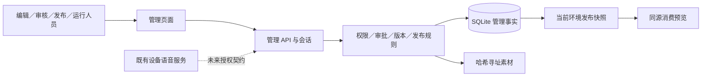

# 后台架构、数据模型与契约

> **最新已定（2026-10-12）**：用户已确认Java业务核心、一期角色生活／事件状态及Java/Python边界，登记09 §0 D-15～17。以[ADR-002](ADR-002-java-business-core.md)为准。本文已有Python管理实现或生产候选讨论保留历史；其中“生产语言尚待讨论”及“最终业务API采用aiohttp”的表述不再作为当前决策。实际迁移及生产能力仍需验证。

2026-10-12 · ADM-01～08 · 实现边界为独立本地管理服务。

## 架构决定

用户确认单台 Linux 云服务器、现有团队维护。复用 Python/aiohttp／SQLite 方向，新建 admin 模块，不重写 `server/` 语音服务。API 控制层在 `admin/server.py`，领域、事务、权限在 `admin/service.py`，约束在 `schema.sql`，Vue 3／TypeScript 页面在 `admin/frontend/`，由 Vite 构建。选择与对比见 [ADR-001](ADR-001-stack-and-deployment.md)。

aiohttp 处理 HTTP，会话、SQLite 和密码散列通过线程卸载，避免阻塞事件循环。首期独立 API 进程＋本地 SQLite WAL，不拆微服务。Linux 使用 Nginx TLS 同源代理＋systemd 非特权进程；管理 API 与语音网关故障隔离。生产部署模板已准备，本轮运行与验收在本机，不声称云端部署完成。

管理服务拥有生产内容版本；未来 App 账号服务拥有角色实例／资产；设备网关拥有设备连接和播放回执。首版不直写后两者，旧后台设计中的用户／设备表不会被重复实现成假业务。

## 数据模型

| 表 | 权威事实／约束 |
|---|---|
| `admins` | 真实／预览身份、PBKDF2 密码、角色和启用状态 |
| `sessions` | 令牌 SHA256、CSRF、8 小时有效期；不保存原令牌 |
| `objects` | 稳定对象 ID、类型、展示名、当前草稿序号 |
| `revisions` | 不可变 JSON 载荷、版本序号、作者、审批状态与审核意见 |
| `revision_refs` | 指向确定版本的依赖边；不可更新或删除 |
| `blobs` | 文件 SHA256、类型、大小、原文件名；存储路径仅用哈希 |
| `releases` | 不可变完整发布清单，含所有依赖载荷 |
| `channels` | preview／staging 的当前发布指针 |
| `channel_history` | 追加的发布／回退／下架记录 |
| `executions` | 对某发布中事件的本地执行结果、操作者、时间 |
| `audit` | 成功与拒绝的追加操作记录；数据库触发器禁改／删 |
| `idempotency` | 操作者＋键唯一，请求摘要与原响应；首版保留至数据库生命周期结束 |
| `schema_version` | 加法式 schema v1；不自动降级 |

统一关系：asset revision ← character revision ← content revision ← event revision ← release manifest ← channel。载荷字段对应：

- asset：digest/media_type/size/filename。
- character：persona/voice/asset_revision。
- content：text/character_revision。
- event：content_revision/trigger/target/cooldown_seconds/ttl_seconds；daily_time 增 local_time/timezone；game_hook 增 hook。target 首版仅 app_preview。

触发规则是内容配置，可手動预览验证，不承诺已调度或 TTS 发声。未来调度必须另建 due_at/expires_at、接收／开始／完成／失败／取消与重复投递契约。

## 状态、事务和接口

版本：draft → in_review → approved / rejected。修改一律创建新 draft；已保存载荷不可原地修改。审核依赖必须 approved，审核人与作者不同。发布依赖闭包通过且无同对象多版本冲突时，一事务创建 release＋更新 channel＋写 history/audit/idempotency。

所有业务写使用 `BEGIN IMMEDIATE`，提交原子性与审计一致；保存提供 expected_head，发布／回退／下架提供 expected_release_id。事务失败全部回滚；权限和失败代码另事务记录。上传文件先以哈希落盘，事务失败产生的孤立文件可在备份后维护，当前不自动删除。

| 接口 | 目的与权限 |
|---|---|
| GET `/api/admin/config` | 本地模式、角色信息，无敏感数据 |
| POST `/api/admin/login`、`logout` | 真实账号密码会话／撤销会话 |
| POST `/api/admin/preview-login` | 仅显式 local-preview 模式的角色试用 |
| GET `/api/admin/state?audit_after=N` | 登录后读取对象、审批、发布、执行；审计每页 100 条 |
| POST `/api/admin/{action}` | save/upload/submit/review/publish/rollback/withdraw/execute/create_user/set_user；服务端角色校验 |
| GET `/api/admin/blobs/{sha256}` | 登录后读取登记素材；哈希与目录校验 |
| GET `/api/runtime/release?channel=preview` | 登录后消费当前发布快照，不读取草稿 |
| GET `/health` | 仅存活与 schema，不暴露凭证 |

写请求为 JSON，必须带 `X-Admin-CSRF`、`Idempotency-Key`。`{ok:true,data:...}` 或 `{ok:false,error:{code,message},request_id}`；401 未登录、403 权限／自审／CSRF、409 并发／幂等／依赖／冷却、413 体积、422 输入、500 通用异常。UTC 时间、随机对象 ID、版本序号从 1 开始。

对象最多 300，版本最多 1000，发布／执行／历史最多 100 条，明确用于本地小规模；生产前按端点拆分并加入稳定游标分页。审计从 id 升序游标连续查询。请求超时保留原幂等键重试；前端禁重复点击但不替代幂等。

## 安全与演进

密码不出 API、审计或日志；会话 Cookie HttpOnly／SameSite Strict，生产 TLS 后需 Secure。默认本地绑定；Host、Origin、JSON content-type、CSRF 都检查。素材只允许 PNG/JPEG/GLB、32MB 上限、签名检查、哈希文件名，无任意 URL 拉取和路径访问；生产需媒体解码及恶意内容扫描。

角色为服务端权限集合，匿名不能读管理事实，浏览器隐藏按钮不是授权机制。预览身份是开发工具，只有 --local-preview 才注册，真实模式禁止使用预览账号。角色变更、禁用撤销会话。超级管理员也禁止自审及在此改自身权限。

本地数据库触发器保证应用内审计追加，不声称抵抗系统管理员直接改库；生产需独立不可改审计存储。生产 SSO、MFA、租户范围、自动调度、设备命令和 App runtime 接入均为上线门槛，当前无正式发布结论。
