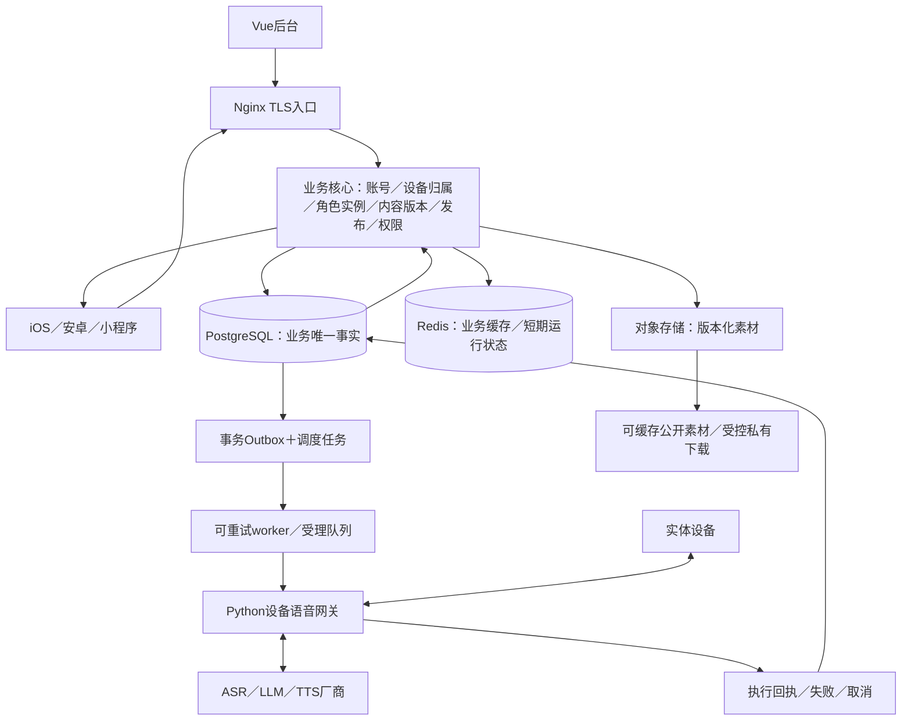

# 生产架构与 DevOps 差距审查

> **最新已定（2026-10-12）**：用户已确认Java业务核心、一期角色生活／事件状态及Java/Python边界，登记09 §0 D-15～17。以[ADR-002](ADR-002-java-business-core.md)为准。本文已有Python管理实现或生产候选讨论保留历史；其中“生产语言尚待讨论”及“最终业务API采用aiohttp”的表述不再作为当前决策。实际迁移及生产能力仍需验证。

2026-10-12 · 讨论稿，未冻结生产语言，也未执行服务迁移。用户已明确：按实际业务比较 Python／Java／Go，团队维护三种语言均无障碍；目标为生产级服务器关系，不接受把本地后台作为最终交付。

## 1. 当前事实与前轮偏差

现有 `admin/` 仅管理域：Python/aiohttp＋SQLite、文件素材、Cookie会话、角色权限、不可变发布、预览执行。19个后端测试、30项浏览器检查通过；GitHub Linux CI [38215926903](https://github.com/007M7/AIapp/actions/runs/38215926903) 成功，对应 ecf9d43。现有设备语音服务是另一个Python进程。App正式账号、角色实例／资产、事件任务、设备授权控制、业务缓存和生产部署尚未打通。

前轮ADR以“少量后台人员”的局部写入估算，不能推出多端完整产品生产数据库或全系统语言选型。缺少对真实用户读负载、设备连接、缓存一致性、生产鉴权、任务可靠性及发布运行的联合评估。当前管理代码是功能验证与可迁移业务规则，不是最终生产架构冻结。

本机装有Docker客户端，守护进程未运行；未声称已完成PostgreSQL/Redis容器集成或容量测试。云机器规格、峰值在线设备、App活跃／QPS、RPO/RTO目标仍需实测／裁定。现有CI是构建与测试，不等于CD和生产门禁。

## 2. 按业务比较语言

| 业务 | Python | Java／Spring | Go |
|---|---|---|---|
| ASR／LLM／TTS／语音流水线 | 已有实现和异步I/O，可继续复用 | 无需为了统一语言重写厂商协议 | 重写收益需延迟／资源压测证明 |
| 账号／绑定／资产／审核／版本／发布 | 能胜任，需补正式框架化契约、迁移、缓存、监控和授权，不只自写路由 | 权限、事务、数据访问与运行治理可用统一成熟生态承接，适合长期业务核心 | 也能胜任，部署产物清晰，但需主动组合事务／权限／迁移／治理组件 |
| 设备长连接与控制 | 现有网关已承接，保持完整语音链不新增跨进程音频跳转 | 可做控制层，无现有替换动机 | 作为连接规模／资源约束下的网关候选，先压测再拆 |
| 事件调度／Outbox worker | 可实现可靠任务，但不能只用进程内定时器 | 与业务事务及状态模型统一，可先同项目独立进程运行 | 适合独立控制worker，但不同语言仍需共享明确契约 |

讨论建议：Java业务核心＋Python语音／AI；Go先保留为网关演进候选。备选为Go业务核心＋Python语音，若更重视部署简洁、当前业务规则规模可控且愿意统一治理组件。不是按团队技能排除某语言，未以推测的内存、QPS作决定；实际部署规格与原型测试参与最终裁定。避免先把一个产品拆成三个语言的多个微服务。

依据：[Spring Boot生产运行能力](https://docs.spring.io/spring-boot/reference/actuator/index.html)、[Go构建产物](https://go.dev/doc/tutorial/compile-install)、[aiohttp异步应用与运行](https://docs.aiohttp.org/en/stable/web_advanced.html)。这是项目取舍，不是三种语言的通用性能排名。

## 3. 生产关系（目标，未实现）

Nginx负责入口、TLS、限流；业务核心负责鉴权和业务规则；网关持有设备socket与语音状态；PostgreSQL拥有最终业务事实；Redis可重建，不能承载唯一资产账或唯一任务状态；对象存储拥有二进制，DB保存哈希与版本。SSO/IAM与应用管理员数据范围分开，平台用户与管理员会话分开。

同一发布事务：版本引用校验→写不可变清单→环境指针更新→审计→Outbox。用户侧角色实例和设备归属不由管理后台直接改表；通过业务服务授权用例处理。发布包与角色实例分开，避免“更新内容包”意外覆盖用户记忆／资产。

## 4. 缓存读写与一致性

| 业务事实／派生内容 | 读路径 | 写／失效 | 失败策略 |
|---|---|---|---|
| 已发布内容快照 | 先确认DB当前发布指针，再读Redis `release:{env}:{release_id}`，未命中回DB并填充 | 不可变release_id；新发布只新增键。回退切换DB指针，不能只改Redis | Redis失败回DB；当前指针不能确认时不伪造发布成功 |
| 发现／官方内容目录 | Redis cache-aside，未命中回DB；TTL带抖动 | 数据事务提交＋Outbox，重试失效目录；版本化目录代际避免旧请求回填污染新代 | 公共目录允许明确有界陈旧；下架执行校验仍查当前发布DB事实 |
| 用户角色／收藏摘要 | 先鉴权与数据范围，再读含user_id与授权代际的键 | 归属／资产事务后失效；变更权限提升代际；强一致操作不依赖摘要 | 私有缓存不得跨用户共用；故障回DB并限流，鉴权不能确认则拒绝 |
| 设备在线／路由位置 | 心跳更新Redis TTL，网关验证真实活连接 | 断开删除、心跳续期、会话代际防旧连接覆盖新连接 | 在线缓存不是播放回执；过期／网关失联不能标执行成功 |
| 会话／限流 | 由身份服务定义Redis会话与共享限流，管理和用户命名空间分开 | 登出／停用撤销；敏感写重查权威身份与权限 | Redis故障时鉴权／限流按安全策略拒绝或权威回源；不能默默放行 |
| 模型／贴图／预渲染公开音频 | 对象存储／CDN，哈希或版本URL | 更新换新URL，旧不可变内容不原地覆盖；私有素材签名URL鉴权 | 原始文件、扫描、发布资源区分；禁止通过公开缓存泄漏私有资料 |

发布／审批、账号归属、资产发放、删除、审计和执行结果以PG为准，不只保存在Redis。候选TTL、热点保护、缓存大小和实际命中率需按业务量实测，未填假生产参数。

Redis cache-aside基础为GET，未命中DB→SET带TTL，写后DEL／版本失效；详见[官方说明](https://redis.io/docs/latest/develop/use-cases/cache-aside/)。项目还需验证并发回填、失效失败、数据库成功而Redis失败、回退及缓存击穿，不能把TTL当全部一致性方案。

## 5. 事件／中间件可靠性

首版候选为PG Outbox＋独立worker；只有任务传递有真实吞吐／解耦需求时才加入Redis Streams或RabbitMQ，不能把cache eviction实例兼作唯一任务存储。若采用队列，可靠任务仍留PG：事务内写任务，提交后投递，消费者按event_id幂等，受理／开始／完成／失败／取消分别落库，崩溃可重试，有过期、次数上限、退避、人工重放和死信处置。

可用PG队列行锁／租约领取任务，`SKIP LOCKED`仅用于竞争领取，不用于普通强一致业务读取；见[官方SELECT说明](https://www.postgresql.org/docs/current/sql-select.html)。队列投递成功不等于设备播放成功；当前固件空闲播放、深睡唤醒能力仍按设备联合契约评估。

## 6. DevOps实际核查

| 阶段 | 本轮状态 | 生产需补齐 |
|---|---|---|
| 需求／设计 | 有PRD、对象／状态／权限、ADR、追踪矩阵 | 完整产品生产范围、语言与中间件讨论冻结、资源与SLO |
| 代码协作 | 有限定范围提交、保留旧WIP | 本轮直接main提交，没有功能分支／PR独立审查；后续高风险变更走分支与审查 |
| CI | GitHub Linux19测试＋TS／构建成功，依赖锁 | PG／Redis真实集成、失效恢复、契约／性能／安全扫描 |
| 构建 | 有可复现前端构建与版本记录 | 唯一不可变发布包／镜像、校验／SBOM，测试环境与生产提升同一产物 |
| CD／配置 | systemd／Nginx模板 | dev/staging/prod隔离、受保护环境、外置密钥／轮换、审批与健康门禁 |
| 数据 | SQLite事务及恢复测试 | PG版本迁移、权限隔离、备份＋实际恢复、RPO/RTO |
| 运行 | request_id、日志、health、操作记录 | 指标／追踪／告警、ready检查依赖、缓存／队列滞后、容量、SLO |
| 回退 | 内容指针回退可用 | 代码／schema／任务／配置兼容回退、排空在途任务、上线演练 |

当前只部分遵循，不能称完整DevOps闭环。缺口记录不是已接受风险；生产上线前应逐项有真实环境证据与负责人。

## 7. 收敛讨论与推进顺序

先讨论并确定业务核心语言及服务边界→冻结PG／Redis／对象存储的事实与一致性契约→补OpenAPI、迁移与缓存／Outbox代码→在真实PG／Redis环境验证主链和故障→补制品、staging部署、监控和恢复演练→与App及固件联合验收→满足生产门禁再上线。

保留现有Vue页面、领域用例、不可变版本规则与测试作为契约基线；后端语言变化通过同一API和状态验证，不用重复画页面来替代服务器升级。生产语言尚待本轮讨论，不能提前将讨论推荐写成已批准决定。
