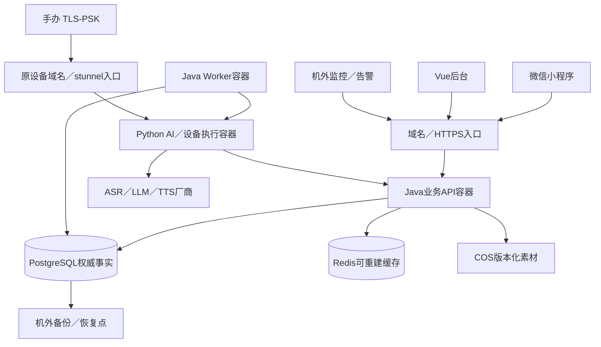

# 生产部署与运维方案

2026-10-12 · v0.2 · **部署阶段已确认，参数建议未冻结、未部署**。依据09 D-15～22及J1讨论基线；D-22确定现有2GB机器先做受限试点，不改变Java业务核心、Python执行、一期小程序优先的确认。

## 1. 实际约束与建议选择

用户已提供：腾讯云、2核／2GB内存／40GB磁盘、已有域名。实例产品（CVM或轻量）、地域、Linux版本、带宽、磁盘类型、域名解析／备案、当前运行负载未核实；没有SSH或控制台部署证据。旧14 §5.5的“210MB、2G充裕”是Python／SQLite时代预算，不作为Java全栈容量依据。

现有2GB机器可先受限联调／试点，须实测总RSS、CPU、磁盘、并发和厂商连接，不据配置承诺生产容量。建议生产采用**单台应用服务器＋容器化Java API／Worker与Python＋PostgreSQL＋Redis＋COS＋机外监控和备份**；数据库位置有两条实施路径：

| 路径 | 应用／数据安排 | 权衡与容量门槛 |
|---|---|---|
| A 自建同机 | 升配应用机；PG与Redis各独立数据服务，持久化卷；COS存素材和离机备份 | 以4核／8GB作为压测候选，非已测最低规格。团队承担数据库补丁、WAL归档、恢复、容量；整机故障影响全部业务 |
| B 托管数据库（优先评估） | Java／Python和小型Redis在应用机；腾讯云PostgreSQL走同地域私网；COS与监控机外 | 应用内存以4GB起作压测候选，不保证2GB能稳定运行。云数据库另有资源与费用；托管减轻数据库运行工作，但业务迁移、备份核验与恢复演练仍由团队负责 |

上述A／B作为后续生产扩容比较。用户本轮已选择**先用现有2GB做受限试点**（09 D-22）；不升配、不购买托管PG。首轮真实PG与小型Redis同机、少量邀请测试；参数及访问规模先测试再定，仍沿用API／Worker独立进程边界。

JDK／数据库版本按J1候选核验；腾讯云产品资料列出PG18，但实际地域、实例版型、内核补丁和插件支持需控制台确认，不能把开源18.6直接等同托管发行号。

### 1.1 2GB试点容量候选与开放门槛

这是一组用于首次实验的**容器内存上限候选**，不是实测RSS或可用性承诺；所有服务一并测启动、业务峰值与备份，不能只看各服务空闲内存。

| 项目 | 候选预算 | 控制措施 |
|---|---|---|
| Java API | 448MiB | JVM堆上限192MiB候选，预留线程／元空间／直接内存；精简依赖 |
| Java Worker | 320MiB | JVM堆上限128MiB候选；单任务起步，领取／重试限额 |
| Python执行 | 192MiB | 厂商推理，首轮AI／音频回合并发1；不在服务器跑本地大模型 |
| PostgreSQL | 256MiB | 小连接池、短事务；shared_buffers／work_mem按联合测试配置 |
| Redis | 64MiB | maxmemory32MiB候选，noeviction；写拒绝与回源限流实测 |
| 系统／容器运行时／入口／轻量监测 | 预留512MiB | 此项为预算而非OS硬限制；不装整套本地监控栈 |

合计1792MiB，若实际可用RAM为2048MiB仅剩约256MiB余量；实际实例内存／内核保留先核实。JVM堆不是进程总内存，备份／素材处理也会消耗余量。若实测启动、回合或备份造成OOM／明显延迟，不降低可靠性要求或合并已确认服务来掩盖，应暂停开放并重新讨论配置。

首次仅邀请测试人员；先单个完整互动／设备回合，再逐步压测。请求体／音频／素材上限、超时、连接池、厂商并发、Worker领取及安全限流都显式配置；受理超限给可恢复结果，不无限排队。上述并发1是试点保护措施建议，不是最终服务容量。

更新时维护窗逐服务替换，不同时运行两套Java服务；备份与重任务错峰，有业务负载时仍验证备份不会抢占核心资源。磁盘先清点系统和镜像实际占用，按DB、WAL、日志、临时区设预算；素材移出系统盘，镜像／日志受控保留。没有可用离机备份及一次真实恢复证据前，不接入不可丢失的正式用户数据。

试点准入证据：总内存及启动峰值、磁盘与WAL余量、正常／弱网／超限／重启、DB事务／权限／重复操作、Redis失败、任务防重放、备份／恢复及外部告警均留证。该试点应有生产工程的数据与权限规则，访问规模受限；通过试点不等于完整生产容量或高可用达标。

## 2. 服务、网络与存储

建议应用用Docker Compose部署，固定镜像digest、重启策略、CPU／内存限制与日志上限；服务非root运行、代码不通过可写源码挂载修改。systemd管理宿主Docker、Nginx／stunnel及必要主机定时任务；同一进程不同时受两套监控拉起。Compose不是高可用集群，容器健康检查也不自动证明或修复业务。

既有设备源码中stunnel直接占公网443；14的Nginx stream SNI分流是设计，尚无本轮实机验收。保留设备地址及TLS1.2纯PSK，通过经验证的SNI分流转入环回stunnel，业务域名进入Nginx HTTPS。必须先检验现固件ClientHello的SNI、默认路由、设备握手与网页证书；不能直接套用旧管理nginx模板抢443。无法正确分流时另评估独立公网入口，先保持既有设备可用。

仅入口服务对公网；SSH限制管理来源，PG／Redis／内部服务不发布公网端口。容器内部通信按网络与账号分权；宿主Nginx访问API仅发布loopback端口。云安全组、容器端口映射、IPv4／IPv6与主机防火墙均验外部不可达，不只看ufw输出。托管PG先确认实例能接入相同私网；轻量实例不能假定与CVM网络相同。

数据库目录／卷与镜像分离；应用部署不重建数据库，删除数据卷不是更新步骤。40GB磁盘存OS、有限镜像、受控日志与必要运行数据；模型／纹理／音频进入COS。上传临时文件限制体积、并发和生命周期，机内只留短暂处理区。

COS分公开已审核资源、私有草稿／私人内容、备份权限域；使用哈希／release URL，不原地覆盖正式素材。开启所需版本控制和生命周期，但版本控制不替代独立权限备份；已发布引用的对象不能被通用“过期清理”删除。客户端获取限定对象与有效期的上传／下载授权，不拿云主账号密钥。日志、备份和素材分别计量／限额。

## 3. PostgreSQL、缓存与任务运行

PG是账号、归属、角色、资产、发布、事件、结算、任务、审计的权威事实；Python不直接写业务表。DBA、Flyway迁移、业务运行、只读观察与备份账号分离；应用不使用超级用户或DDL权限。Flyway单独一次性迁移任务，禁止多个API实例同时启动自动改库。

API、Worker连接池的总上限计入PG连接预算，留迁移／运维余量；statement／lock／连接超时、慢SQL、锁等待、索引／autovacuum、表与WAL增长进入监控。work_mem按并发查询而非单连接静态估算；Xmx不等于JVM总RSS，还需原生内存、元空间、线程与容器余量。正式内存与连接数通过联合压测冻结。

Redis独立设置maxmemory与命名空间／TTL，建议首期noeviction，达到上限的写入失败必须处理并报警。缓存失败可有限回源，关键安全计数或撤销状态不确定时拒绝相关操作；PG保留会话／归属权威状态。发布快照、目录、用户摘要的版本键和Outbox失效按J1执行，Redis不是唯一任务队列。故障后缓存可重建，设备在线状态重新观测，不能从陈旧键恢复“已完成”。

Worker从PG持久任务以租约／锁领取，业务事务与Outbox同提交；按任务ID去重、有限退避、过期、取消与人工处置。停止Worker先停止领取再排空，租约超时后回收；物理动作已发送而无回执的任务进入未知／对账，不能因重启全部重播。

首期AI／语音使用现有厂商服务，未将大模型推理或3D生成放入该小服务器。厂商超时、并发配额、计费额度、失败率需监控和限流，不能只压测Java空请求。

## 4. CI/CD、环境与发布回退

本地开发用可复现依赖服务；CI使用真实PG／Redis集成；staging与prod使用不同账号、数据库、缓存、素材前缀和凭证。现2GB机器可作受限staging；如果部署生产到同机，必须单独算两套资源，不能同时做满负载测试。同主机两套环境不具备物理隔离。

建议流水线：功能分支／PR → 单元／契约／真实中间件集成与安全检查 → 构建固定镜像、SBOM与提交清单 → 镜像仓库 → staging同镜像部署与用例验收 → 生产门禁 → 备份可恢复性检查 → 兼容迁移 → 更新应用 → 就绪及业务冒烟 → 观察／回退。

生产机器不git pull后临时编译，不从源码目录直接改服务；同一已验镜像提升生产，release清单记录Git SHA、digest、配置版本、schema版本、角色内容release与操作者。镜像仓库可评估腾讯TCR或现有私有仓库，套餐／访问支持与成本待核验，不假定已经购买。

私有GitHub库的Environment审批等能力按账号计划核验；如不可用，保留由指定发布人执行的受控制品发布步骤和记录，不把workflow_dispatch按钮当完整审批。生产凭证最小权限、外置文件／Secret挂载、禁止进入日志镜像；云IAM凭证、DB账号、应用管理员是三个不同权限层，TOTP不替代云控制台权限治理。

小服务器首期默认维护窗口逐服务更新：暂停Worker领取 → API停止受新写并排空 → 在schema兼容窗口更换应用 → 业务验收 → 恢复领取。Python设备WS重启单独通知／排空／重连验证。资源允许且实测后可做API蓝绿切换；不在2GB机器强行双套启动，也不承诺设备长连接零中断。

代码回退只切前一个digest；内容回退切发布指针；配置回退按版本；任务按新旧消息兼容处理。DB有新业务写入后不随代码回退恢复旧备份；优先保持兼容或前向修复。不可逆迁移单独发布，恢复数据只作为明确事故处置，并核对恢复点后外部设备执行和用户操作。

## 5. 备份与恢复

建议可供评审的目标：**RPO≤5分钟、RTO≤60分钟**，分别表示最多丢多少数据、多久恢复核心服务；不是已验证承诺。先用真实数据量、带宽、归档与新机恢复演练校准，若不满足则提高配置／改变数据托管或调整目标。

托管PG开启全量及日志备份，核验保留期、可恢复时间和权限，定期恢复到隔离实例；恢复成功还需用户／资产／版本／任务与审计核对。自建PG建议pgBackRest全量／增量与WAL持续归档至离机COS；工具对COS端点、认证、加密及PG18兼容需实际验证，不把“支持S3类接口”当COS联调完成。

自建候选策略：每周全量、每日增量、连续WAL归档，目标可恢复窗口至少7天；重要发布前额外备份／恢复点。保留链路与WAL由备份工具校验清理，不能按文件日期乱删；每日pg_dump可辅助逻辑导出，不能替代PITR。归档间隔／延迟必须实测能支持5分钟目标，归档失败可能积压填满磁盘，应有独立告警。

数据库备份、素材清单／哈希／COS版本、部署配置分别可恢复，凭证加密且解密材料另受控。备份写入账号不具备任意删除历史备份权限，关键备份有独立保留副本；单纯同账号版本控制不能抵抗账号误操作。每月及重大迁移后恢复演练，记录时间、可恢复点、数据核对、任务防重放与失败整改。

恢复流程：限制写入 → 保全现状 → 在隔离目标恢复PG和所需素材版本 → 核对业务／回执及迁移兼容 → 换连接配置 → 从外部验登录／角色／发布／记录 → 有控制地恢复Worker。备份成功的邮件不能代替该流程验收。

## 6. 监控、告警与例行维护

优先腾讯云可观测平台主机指标、外部HTTPS探测、应用指标上报与受控集中日志。Prometheus／Grafana／Loki全套不挤入现2GB机器。Actuator与DB exporter仅内网／鉴权访问；公网health只给最小存活信息。进程liveness不因Redis短故障被反复杀重启；readiness区分必须依赖和允许降级依赖。

| 对象 | 必须观测／告警 | 处置 |
|---|---|---|
| 机器 | CPU、内存／OOM、磁盘／inode、带宽、异常重启 | 限流／停止非核心任务、核查容量；日志与镜像受控清理，不删PG目录 |
| API／身份 | 错误率、P95、登录／角色读取／互动成功率、越权／MFA异常 | 关联request_id与发布版本，回退／关闭问题入口 |
| PG | 连接池等待、锁／慢SQL、容量、WAL归档延迟、备份可恢复年龄 | 查慢查询／锁持有者，限制写入，处理归档或恢复 |
| Redis | 内存、命中率、写入拒绝、失效积压 | 限制回源，安全操作按失败策略处理，避免缓存故障击穿PG |
| Worker／Python | 最老待办年龄、重试／未知结果、回执延迟、厂商配额／失败、设备连接 | 暂停问题任务、对账／补偿；不自动重播未知物理动作 |
| 域名／素材／备份 | 证书到期、外部不可达、COS缺文件、备份失败／恢复演练失败 | 指定责任人、处置链接、升级时限；主机离线告警依赖机外监控 |

初始告警阈值、业务SLO和接收人随压测／试点冻结；应区别轻微波动与持续错误，并演练一次真实可达告警。本轮未配置或向任何人发送通知。日志按request_id／event_id关联，隐去凭证、私人文本和音频；审计受业务权限保留，运营保留期、隐私删除与备份清理规则统一。

每日自动核查存活、备份／归档、磁盘与任务积压；每周核查容量、告警噪声与依赖漏洞；每月及重大变更后恢复演练，OS／数据库／容器安全补丁先在staging验证。维护任务均有负责人和记录，目前负责人待指定。事故按发现→止损→恢复→数据／任务对账→复盘→整改验收执行。

## 7. 实施顺序与准入证据

1. 按D-22保留现有2GB机器，核验腾讯实例、系统、域名、带宽、可用内存／磁盘和已有设备入口；先试容量，不购买A／B资源。
2. 编写Compose／Dockerfile、Nginx分流、Secret、数据库账号／Flyway、备份和监控配置；可从空环境复建，真实测试443／PG／Redis端口隔离。
3. Java与小程序首个闭环实现并联调，现有Python／SQLite管理基线不冒充新服务。选定素材按D-19导为新草稿。
4. staging验证登录／TOTP／权限、版本发布、互动／记录、缓存失败、任务重启、回退与整套数据恢复；联合压测资源及AI厂商限制。
5. 生产门禁检查证书、配置、密钥、备份恢复、告警、迁移兼容和发布清单；指定负责人后受控部署，试点观察有证据再扩大。

上线前必须有：可重复制品、正式PG／Redis集成、443联合验证、真机核心链路、失败／缓存／任务／恢复／回退演练、容量与告警证据。单机方案具有整机故障停机边界；托管PG也不使单台应用服务器成为高可用，持续服务目标需要另评估多实例。

## 8. 现状及官方依据

已存在Python管理systemd／Nginx模板、SQLite备份与本地验收、Linux管理CI；Java工程与本方案部署、云PG／COS接入、备份／监控／CD仍未实施。旧[operations.md](operations.md)仅描述本地管理基线，不作为本方案已部署证据。

- [Docker Compose生产使用](https://docs.docker.com/compose/how-tos/production/)、[端口发布](https://docs.docker.com/engine/network/port-publishing/)、[Secret挂载](https://docs.docker.com/compose/how-tos/use-secrets/)：单机部署、网络与凭证参考。
- [PostgreSQL连续归档／PITR](https://www.postgresql.org/docs/current/continuous-archiving.html)、[pgBackRest](https://pgbackrest.org/user-guide.html)：自建数据恢复依据。
- [腾讯云PG功能](https://cloud.tencent.com/document/product/409/127570)、[云PG恢复](https://cloud.tencent.com/document/product/409/11642)：版本及托管恢复；实际资源仍需核验。
- [COS版本控制](https://intl.cloud.tencent.com/zh/document/product/436/19883)、[生命周期](https://cloud.tencent.com/document/product/436/56548)：素材与历史对象管理。
- [腾讯云事件告警](https://cloud.tencent.com/document/product/248/85092)、[Spring Boot运行端点](https://docs.spring.io/spring-boot/reference/actuator/endpoints.html)、[Redis内存淘汰](https://redis.io/docs/latest/develop/reference/eviction/)：监控与内存策略参考。
- [GitHub部署环境](https://docs.github.com/en/actions/how-tos/deploy/configure-and-manage-deployments/manage-environments)：计划与私有库能力约束须核实。

以上是资料核实和本项目建议，未将云功能支持、参考工具示例或已有CI等同本项目生产测试结果。
