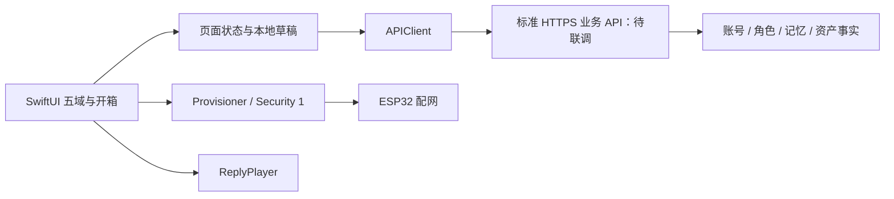

# iPhone 架构与实现边界

> 2026-10-03 · 正式边界来自 23、14、18、D-13／D-14；以下局部实现是可替换工程基线，不构成 Founder 架构冻结。

## 1. 系统模型

App 不进入设备 TLS-PSK 域、不持有厂商 key、不直接存业务数据库。BLE 只承接已有协议；手机文字回合不等于设备同步出声。

## 2. 模块职责与所有权

| 模块 | 拥有 | 不拥有 |
|---|---|---|
| AppEnv | 导航、共享 API／播放器、开箱展示状态 | 账号资产、正式契约签署 |
| Features | 页面组合、输入、动作及结果反馈 | 另立包权益、记忆和计费规则 |
| RemoteCollection | 列表状态、请求代次、错误与恢复 | 业务数据真源或持久缓存 |
| OnboardingDraft | 步骤、名字、本机阅读标记 | 角色命名、入册、认主、正式签署 |
| ServerConfig／APIClient | 开发期接入与 HTTP 边界 | 正式登录方案、服务端错误的产品解释权 |
| Device | BLE 生命周期、串行安全会话 | 出厂身份、量产绑定安全裁决 |
| Audio | 回复播放与停止 | 后端回合取消、设备打断 |
| Content | 静态文案代码载体、解码模型 | 承诺正本与正式用户数据 |

## 3. 本轮取舍

候选一：保留各页面 try? → 空数组，改动小但失败与空态不可区分。候选二：引入完整 Repository、缓存与状态框架，能力多但目前无真实后端契约，迁移成本过高。采用局部共享 RemoteCollection，实际有设备、角色、包、动态和记录多个复用点。

结果：统一未配置／加载／空／成功／失败，阻止旧请求在身份变化后回填；仍由 APIClient 调用已有端点，不加持久缓存和自动重试。代价：详细 HTTP 错误分类、离线缓存及全局账号撤销仍需正式登录方案。高并发复杂页面出现后再评估独立 ViewModel／Repository，不提前改写整仓。

本地开箱草稿与服务端资产分离；继续预览不发请求、不创造契约事实。待官方首包、命名和签署接口明确后，逐步换成服务成功驱动，不把本地草稿迁成真实资产。

## 4. 失败、安全与兼容

请求取消不宣称失败；显式重试由用户发起，避免对写操作自动重试。列表结果校验请求代次和接入 revision；服务器或 token 改变使界面重新加载。本轮仅改善现有开发接入，不批准手填 token 作为正式登录。

token 当前仍存在 UserDefaults：隐藏输入不等于安全存储；正式分发前需按 Q-88 完成认证与 Keychain 策略。配网无 PoP、API 字段草案、依赖厂商、后端未完成均为已知缺口，不自动接受风险。

本轮回退可还原受影响 Swift 文件和工具脚本；开箱新增本地 draft key 不影响服务端数据。既有 done 标记兼容；旧本地 contract 布尔标记不作为正式签署证据。权限和行为修改需重跑真实配网与播放回归。
